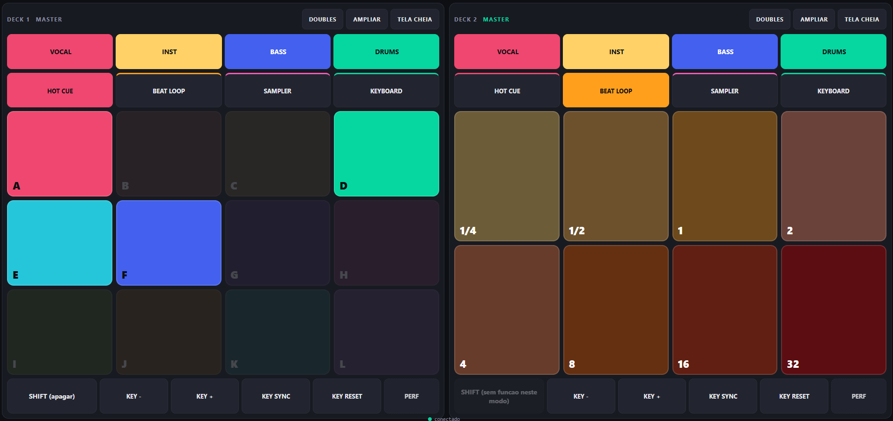

# PadBridge

[English](README.en.md) · **Português**

Transforme um tablet Android em um controlador de **pads e stems para o Rekordbox** (Windows), para usar ao lado do seu controlador DJ.

A tela do tablet manda MIDI por um programinha no PC (a "ponte") até uma porta virtual do [loopMIDI](https://www.tobias-erichsen.de/software/loopmidi.html), e o Rekordbox lê essa porta com um **arquivo de mapeamento importável** (você não precisa usar o MIDI Learn pad por pad).

```
Tablet (navegador)  --USB/Wi-Fi-->  PadBridge (PC)  -->  loopMIDI "PadBridge"  -->  Rekordbox
        ^                                                                              |
        '------------------ estado dos stems (feedback) <------------------------------'
```

> Projeto independente, sem relação com Pioneer DJ / AlphaTheta ou com o Rekordbox. Os nomes pertencem aos seus donos.



## O que ele faz
- 2 decks lado a lado, com **AMPLIAR** (um deck em tamanho grande) e **TELA CHEIA**
- **Stems** (Vocal / Inst / Bass / Drums) com o estado acompanhando o Rekordbox, e o botão **MODO** para alternar entre mute e solo
- 4 modos de pad: **Hot Cue** (12 pads, A-L), **Beat Loop** (8), **Sampler** (8 slots, 4 bancos) e **Keyboard** (8)
- **SHIFT**, **KEY -**, **KEY +**, **KEY SYNC**, **KEY RESET**
- Ícone na bandeja do Windows, `adb reverse` automático (USB) e início junto com o Windows

## Requisitos
| Item | Detalhe |
|---|---|
| PC | Windows 10 ou 11 |
| Rekordbox | 7.x (testado na 7.2) |
| [loopMIDI](https://www.tobias-erichsen.de/software/loopmidi.html) | gratuito, cria a porta MIDI virtual |
| Tablet Android | feito para 1340x800 em paisagem; qualquer navegador moderno |
| [Android platform-tools (adb)](https://developer.android.com/tools/releases/platform-tools) | só para o modo USB |
| Python 3.12 | só se for rodar do código-fonte ou gerar o `.exe` |

## Instalação (passo a passo)

### 1. Obter o PadBridge
Clone o repositório:
```powershell
git clone https://github.com/SEU-USUARIO/PadBridge.git
cd PadBridge
```
Depois escolha **uma** forma de rodar:
- **A) Executável (recomendado para o dia a dia):** gere o `.exe` com `scripts\construir_exe.bat`. O resultado fica em `dist\PadBridge.exe`, um arquivo único que não precisa de Python. Para usar em outro computador, copie só esse arquivo.
- **B) Código-fonte (para testar e desenvolver):** `scripts\rodar.bat`, que cria o ambiente virtual na primeira vez e roda no terminal.

### 2. Criar a porta no loopMIDI
1. Instale e abra o loopMIDI.
2. Em *New port-name* digite exatamente **`PadBridge`** e clique em **+**.
3. Nas opções do loopMIDI, marque **Autostart loopMIDI** para ele subir com o Windows.

Deve existir **uma única** porta chamada `PadBridge`.

### 3. Importar o mapeamento no Rekordbox
1. Abra o Rekordbox **depois** do loopMIDI (ele só lê as portas MIDI ao iniciar).
2. Vá em *Preferências > Controlador > aba MIDI*.
3. Selecione o dispositivo **PadBridge** e use **Importar** com o arquivo `mapping/PadBridge.midi.csv` deste repositório.

Essa importação é feita uma vez por instalação do Rekordbox.

### 4. Instalar o adb (modo USB)
1. Baixe o [platform-tools](https://developer.android.com/tools/releases/platform-tools) e extraia em `C:\platform-tools`, de modo que exista `C:\platform-tools\adb.exe`.
2. A ponte procura o adb sozinha em: `C:\platform-tools`, `C:\adb`, a pasta do Android SDK, `platform-tools` ao lado do programa e o `PATH`. Se estiver em outro lugar, indique o caminho com `--adb` ou no campo `adb` do `padbridge_config.json`.

### 5. Preparar o tablet
1. Ative as **Opções do desenvolvedor** (toque 7 vezes em *Número da versão*, em Sobre o tablet).
2. Ative a **Depuração USB**.
3. Conecte o cabo e deixe o modo USB em **Transferência de arquivos**.
4. Aceite o pop-up *Permitir depuração USB deste computador?* e marque *Sempre permitir*.

### 6. Rodar
1. Inicie a ponte: `dist\PadBridge.exe` (ícone na bandeja) ou `scripts\rodar.bat` (terminal).
2. No navegador do tablet abra **`http://localhost:8765`**. Dica: adicione à tela inicial.
3. No Rekordbox, carregue uma track num deck e toque num pad.

## Dia a dia
1. Ligue o PC: o loopMIDI e o PadBridge sobem sozinhos (marque *Iniciar com o Windows* no menu do ícone).
2. Abra o Rekordbox.
3. Conecte o tablet por USB e abra `http://localhost:8765`.

O ícone da bandeja mostra o estado: **verde** = tablet conectado, **amarelo** = esperando o tablet, **vermelho** = problema (por exemplo, loopMIDI fechado). Clique com o botão direito para ver o MIDI, o USB e o último estado vindo do Rekordbox, reconectar o tablet, abrir a pasta ou o log.

## Usar por Wi-Fi (sem cabo)
```powershell
scripts\rodar.bat --wifi
```
No tablet, abra `http://IP-DO-PC:8765` (descubra o IP com `ipconfig`). O PC e o tablet precisam estar na mesma rede. Na primeira vez, permita o Python/PadBridge no Firewall do Windows em **Redes privadas**, ou libere a porta (PowerShell como administrador):
```powershell
New-NetFirewallRule -DisplayName "PadBridge" -Direction Inbound -Protocol TCP -LocalPort 8765 -Action Allow -Profile Private
```
Sem `--wifi`, a ponte só aceita conexões do próprio PC (mais seguro).

## Opções
```
--console        roda no terminal, sem ícone na bandeja
--debug          mostra todo o MIDI enviado e recebido
--porta NOME     trecho do nome da porta do loopMIDI (padrão: PadBridge)
--http 8765      porta do servidor
--wifi           aceita conexões da rede, além do USB
--adb CAMINHO    caminho do adb.exe
--sem-adb        não rodar o adb reverse automaticamente
--sem-feedback   não escuta o MIDI vindo do Rekordbox (diagnóstico)
```
Também dá para fixar valores em `padbridge_config.json`, criado ao lado do programa (`porta_midi`, `http`, `wifi`, `adb`, `usar_adb`, `feedback`). O log fica em `padbridge.log`, na mesma pasta.

## Problemas comuns
| Sintoma | O que fazer |
|---|---|
| Os pads respondem na tela mas o Rekordbox não reage | Rode com `--debug`. Você deve ver `[enviado]` e logo depois `[chegou] ... (eco do que enviamos)`. Se o `[chegou]` não aparecer, a porta do loopMIDI travou: remova a porta, feche e abra o loopMIDI e crie `PadBridge` de novo. Se aparecer, confira se o dispositivo **PadBridge** está selecionado no Rekordbox e reinicie o Rekordbox. |
| O console diz que não achou a porta MIDI | O loopMIDI precisa estar aberto com a porta `PadBridge`. Para outro nome, use `--porta`. |
| `localhost:8765` não abre no tablet | O `adb reverse` não está ativo. Veja o ícone ou o log: instale o adb, aceite a depuração USB no tablet e use *Reconectar o tablet agora*. |
| IP do PC "carregando" sem abrir | Você não usou `--wifi`, ou o Firewall está bloqueando. Veja a seção Wi-Fi. |
| Aparece um dispositivo "PadBridge 2" no Rekordbox | Há portas duplicadas no loopMIDI. Deixe só uma. |
| Os stems no tablet não acompanham o Rekordbox | O mapeamento precisa ser o `PadBridge.midi.csv` atual e o Rekordbox precisa ter sido reiniciado depois de importá-lo. |
| O Windows/SmartScreen avisa sobre o `.exe` | É comum em programas sem assinatura digital. Gere o `.exe` você mesmo a partir do código. |

## Desenvolvimento
```powershell
pip install -r requirements-dev.txt
python tools/gerar.py          # regenera mapping/PadBridge.midi.csv e padbridge/web/index.html
python tests/test_servico.py   # lógica do serviço
python tests/test_ui.py        # tela + mapeamento (Playwright; rode "playwright install chromium" antes)
```
A estrutura e o protocolo MIDI estão em [docs/PROTOCOLO.md](docs/PROTOCOLO.md). A tela e o mapeamento nascem do mesmo gerador, então ficam sempre coerentes.

## Limitações
- Groove Circuit e Slide FX ficaram de fora (dependem de plano/extensão ou não respondem por MIDI).
- O botão **MODO** (mute/solo) é uma função global do Rekordbox: os dois decks mostram sempre o mesmo estado. Requer reimportar o mapeamento; o retorno de estado dele ainda não foi confirmado em todas as versões.
- Só Windows.

## Licença
MIT. Veja [LICENSE](LICENSE).
